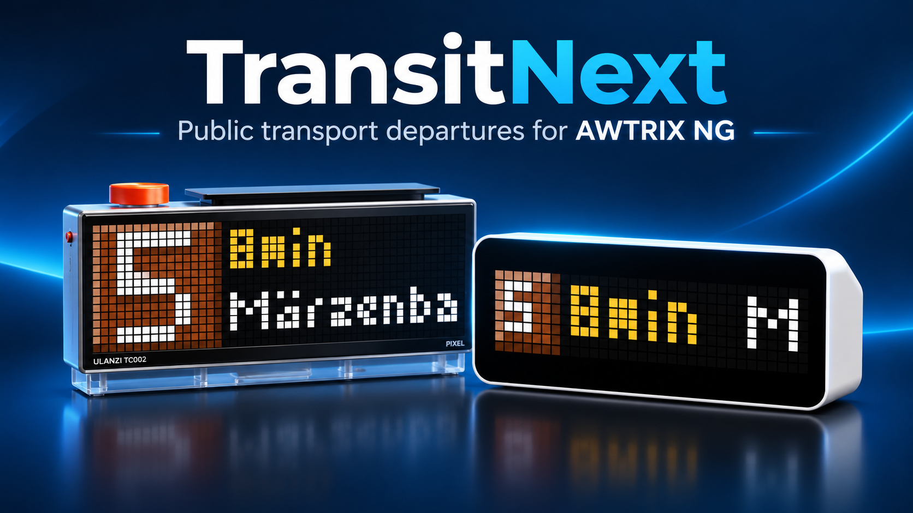

# TransitNext

**Die nächste Abfahrt auf deiner Ulanzi-Uhr – als kompakte Bus- und Bahnsteiganzeige für AWTRIX NG.**

TransitNext zeigt Fahrplaninformationen des öffentlichen Nahverkehrs direkt auf dem LED-Display einer **Ulanzi TC001 oder TC002 mit AWTRIX-NG-Firmware**. Statt eine einzelne Linie zu verfolgen, zeigt die Anwendung die nächste Abfahrt an einem ausgewählten **Bussteig oder Bahnsteig**. Fahren dort mehrere Linien ab, werden ihre Abfahrten gemeinsam berücksichtigt.

## Funktionen

- **Nächste Abfahrt:** Liniennummer, Fahrziel und Abfahrtszeit auf dem Display; optional als Minuten-Countdown.
- **Echtzeitdaten:** Verspätungen oder frühere Abfahrten werden angezeigt, sofern der Datenanbieter entsprechende Informationen bereitstellt.
- **Steigbezogene Anzeige:** Mehrere Linien am selben physischen Steig werden zusammengefasst; unterschiedliche Steige und Gegenrichtungen bleiben getrennt.
- **Pixeloptimierte Darstellung:** Eigene Layouts für TC001 (32 × 8 Pixel) und TC002 (52 × 16 Pixel) mit farbigen Linienfeldern und Laufschrift für längere Fahrziele.
- **Busanimation:** Optionale Animation beim Erreichen der Abfahrtsminute; Fahrtrichtung wählbar.
- **Mehrere Haltestellen und Uhren:** Der Installer unterstützt mehrere Haltepunkte und die Einrichtung auf mehreren ausgewählten AWTRIX-NG-Uhren.
- **Direkter Betrieb:** Die Anwendung läuft als Berry-Skript auf der Uhr. Home Assistant, MQTT und ein zusätzlicher Server sind nicht erforderlich.

## Installation

**[TransitNext-Installationsassistent im Browser starten](https://q14six.github.io/TransitNext/)**

Der GitHub-basierte Installer führt in vier Schritten durch die Einrichtung:

1. **Uhren finden:** Nach ausdrücklicher Freigabe AWTRIX-NG-Uhren im lokalen Netzwerk suchen oder per IP-Adresse hinzufügen und die gewünschten Geräte auswählen.
2. **Haltestellen:** Nach Ort und Haltestelle suchen und die gewünschten Bus- beziehungsweise Bahnsteige hinzufügen.
3. **Darstellung:** Anzeigeformat, Aktualisierungsintervall, Animation und weitere Optionen festlegen.
4. **Installieren:** Auswahl prüfen und TransitNext auf den ausgewählten Uhren installieren.

Der Installer fragt Geräte im lokalen Netzwerk erst nach einer bewussten Nutzeraktion ab. Der Netzwerkscan benötigt eine zusätzliche ausdrückliche Freigabe. Das Displayprofil wird automatisch erkannt; passwortgeschützte Uhren werden unterstützt. Doppelte Installationen derselben Haltestelle werden vermieden. Die im Repository enthaltenen Skriptvorlagen werden erst bei der Einrichtung passend konfiguriert.

**Voraussetzungen:** AWTRIX NG mit aktivierter Skriptunterstützung, Internetverbindung der Uhr und ein Browser mit Zugriff auf das lokale Netzwerk. Abhängig von den Sicherheitsregeln des Browsers können automatische Erkennung und direkte Installation eingeschränkt sein. Der Online-Installer setzt eine aktivierte GitHub-Pages-Seite voraus. Die [`index.html`](index.html) ist auch zum lokalen Öffnen vorgesehen.

## Standardeinstellungen

| Option | Standard |
|---|---|
| Aktualisierung | 5 Minuten |
| Suchzeitraum | 24 Stunden |
| Zeitanzeige | Uhrzeit + Live-Verspätung |
| Keine Abfahrt | In der App-Rotation überspringen |
| Bei 0 Minuten | Busanimation |
| Linienfeld 3D-Stärke | 3 – Kräftig |
| Animation | Links nach rechts |

Die Abfahrtsdaten stammen aus **Transitous**. Ob Echtzeitdaten, exakte Haltepositionen und Fahrziele verfügbar sind, hängt von den angebundenen Verkehrsunternehmen ab.

**Version:** `20261113.233708` · **Lizenz:** [MIT](LICENSE.md) · **Versionshinweise:** [RELEASE.md](RELEASE.md)

---

## English

**Your next departure on a Ulanzi clock — a compact bus-stop and platform display for AWTRIX NG.**

TransitNext brings public transport departures to **Ulanzi TC001 and TC002 devices running AWTRIX NG firmware**. It follows an actual boarding position, **not just one route**: departures of different services using the same platform or bus bay are considered together.

### Features

- **Next departure:** Route number, destination and departure time, with an optional minutes countdown.
- **Live information:** Delay or early-running indicators when provided by the upstream timetable service.
- **Platform-based departures:** Multiple routes at the same physical boarding position are grouped; other platforms and opposite directions remain separate.
- **Display-specific layouts:** TC001 (32 × 8) and TC002 (52 × 16), with colored route labels and scrolling destinations.
- **Optional bus animation:** Appears around departure time with configurable travel direction.
- **Multi-device setup:** Configure stops and install on several selected AWTRIX NG clocks.
- **On-device operation:** Runs as a Berry script without Home Assistant, MQTT or a separate host server.

### Installation

**[Open the TransitNext installer](https://q14six.github.io/TransitNext/)**

The GitHub-hosted wizard guides you through **Discover clocks → Select stops → Display settings → Install**. It identifies compatible clock display sizes, supports password-protected clocks and avoids installing the same stop twice. Stop selections are assigned to the clocks chosen at the start.

**Requirements:** AWTRIX NG with scripting enabled, an internet-connected clock and browser access to the local network. Browser security rules may limit LAN discovery or direct installation. The online link requires GitHub Pages to be enabled; [`index.html`](index.html) can also be opened locally.

Default settings: **5-minute refresh · 24-hour search window · clock time with live delay · skip when no departures · bus animation at 0 minutes · 3D line strength 3 · left-to-right animation.**

Timetable data is provided by **Transitous**; available coverage, platform details and realtime data depend on its upstream sources.

**Release:** [RELEASE.md](RELEASE.md) · **License:** [MIT](LICENSE.md)

**Entwickelt von / Developed by Q14siX**
