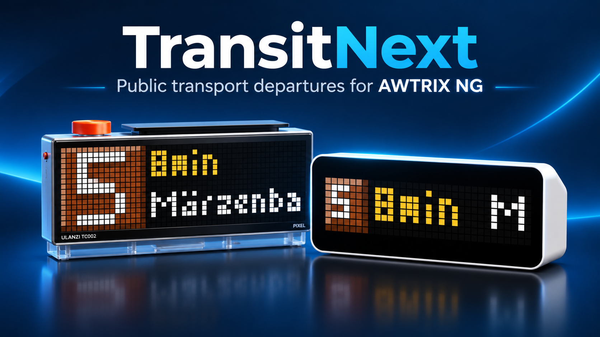

# TransitNext – Erstveröffentlichung / Initial Release

**Version `20261113.233708` · 13. November 2026**

## Deutsch

**Aktualisierung:** Der Netzwerkscan startet ausschließlich nach ausdrücklicher Freigabe. Die HTML-Seite fragt beim Öffnen keine lokalen Uhren ab und lädt Skriptvorlagen erst beim Installieren. Zugangsdatenfelder erscheinen nur bei einer erforderlichen Anmeldung oder nach bewusster Auswahl. Der originale Buy-me-a-Coffee-Button bleibt in README und Installer eingebunden; die bisherige SVG-Ersatzdatei wurde entfernt.

Mit der Erstveröffentlichung von **TransitNext** erhalten Ulanzi **TC001** und **TC002** mit **AWTRIX NG** eine eigenständige Abfahrtsanzeige für Bus und Bahn.

### Enthaltene Funktionen

- Anzeige der nächsten öffentlichen Verkehrsabfahrt mit **Liniennummer, Fahrziel und Uhrzeit**.
- Anzeige von **Echtzeitabweichungen**, sofern Fahrplandaten diese enthalten; alternativ Minuten-Countdown.
- **Bahnsteig- und bussteigbezogene Zusammenfassung** der Abfahrten mehrerer Linien – ohne Beschränkung auf eine einzelne Linie.
- Optimierte LED-Layouts für **TC001 (32 × 8)** und **TC002 (52 × 16)**, inklusive farbiger Linienfelder und Laufschrift.
- Optionale **Busanimation zur Abfahrtsminute** und anpassbare Darstellungsparameter.
- Mehrseitiger **HTML-Installationsassistent** zur Suche, Auswahl und Einrichtung mehrerer AWTRIX-NG-Uhren, einschließlich geschützter Geräte.
- Automatische Erkennung des kompatiblen Displayprofils, Prüfung vorhandener Installationen und Vermeidung doppelter Haltestelleneinträge.
- Direkte Ausführung als **Berry-Skript auf der Uhr** ohne Home Assistant, MQTT oder zusätzlichen Server.

### Installation

Der [TransitNext-Installer](https://q14six.github.io/TransitNext/) führt Nutzer durch die Einrichtung. Für den direkten Zugriff vom Browser auf Geräte im lokalen Netzwerk gelten dessen Sicherheits- und Netzwerkbeschränkungen. Die Datenversorgung erfolgt über Transitous; Verfügbarkeit von Haltestellen- und Echtzeitinformationen ist regional unterschiedlich.

Die Erstveröffentlichung wurde mit simulierten Geräte- und API-Antworten geprüft. Eine vollständige Prüfung auf realer AWTRIX-NG-Hardware ist noch offen.

---

## English

**Update:** Network scanning requires explicit opt-in, and no local clocks are contacted when opening the installer. Script templates load only during installation, while login fields appear only when needed or requested. The official Buy Me a Coffee image remains in the README and installer; the previous replacement SVG has been removed.

The first public release of **TransitNext** brings an independent bus and rail departure display to **Ulanzi TC001 and TC002** clocks running **AWTRIX NG**.

### Included features

- Next public transport departure with **route number, destination and departure time**.
- **Realtime deviation** where available, or an optional minutes countdown.
- **Platform/bus-bay grouping:** Departures of multiple routes sharing the same physical boarding position appear together.
- Pixel-optimized layouts for **TC001 (32 × 8)** and **TC002 (52 × 16)**, including route colors and scrolling destinations.
- Optional **departure-time bus animation** and configurable display behavior.
- A guided **HTML installer** to discover, select and configure multiple AWTRIX NG devices, including password-protected clocks.
- Automatic compatible display detection, existing-app checks and duplicate-stop prevention.
- Native **Berry script** execution without Home Assistant, MQTT or a separate server.

### Setup

Use the [TransitNext installation wizard](https://q14six.github.io/TransitNext/) to configure the app. Direct browser access to local devices depends on browser and network security policies. Transitous supplies timetable data; regional stop coverage and realtime details vary.

The initial release has been checked using simulated device and API responses. Full validation on physical AWTRIX NG hardware is still outstanding.
